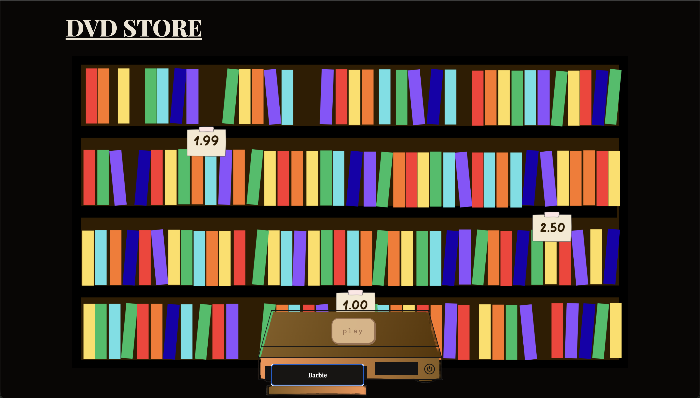
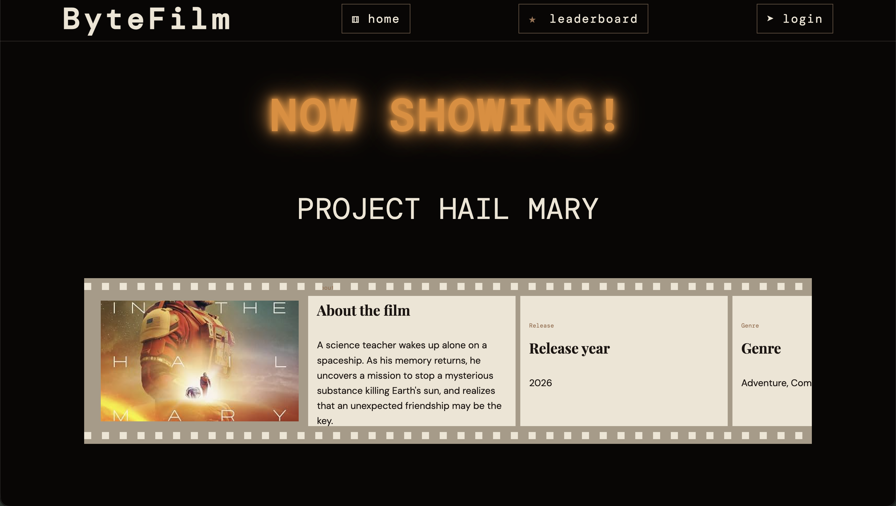
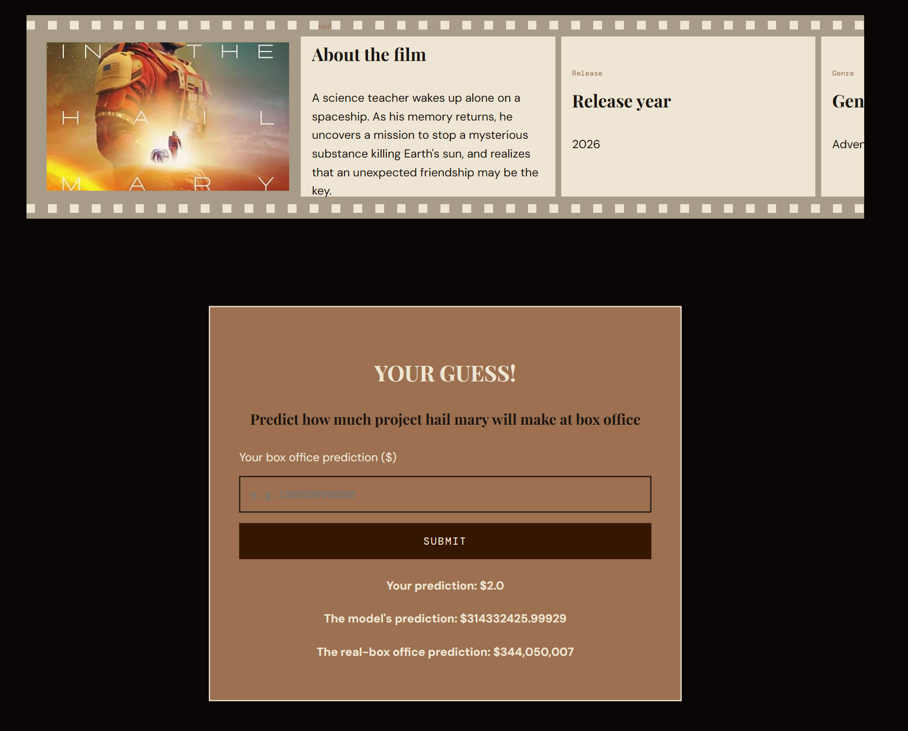
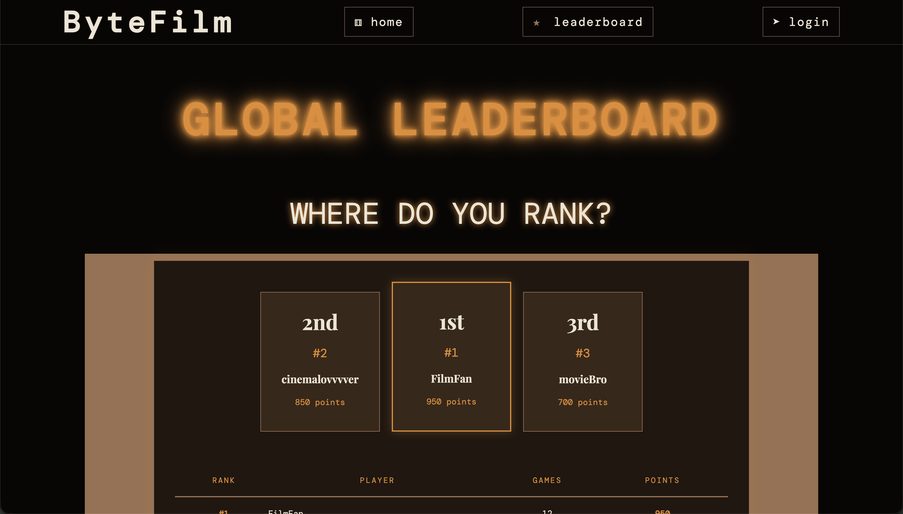
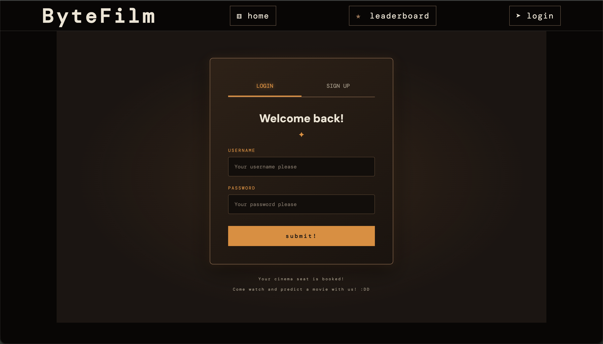
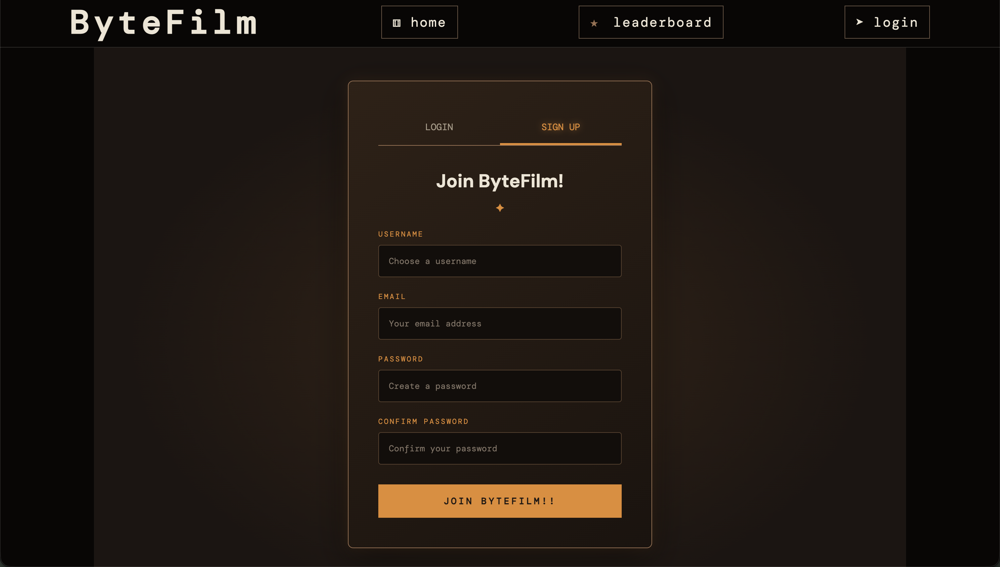

# ByteFilm
By: PoliteDefensiveCapybara  
In: Durhack

Huge thank you to Brian Fritz and ADITYA JILLA for powering this project through the [Online Movie Database](https://www.omdbapi.com/) and this [database](https://www.kaggle.com/datasets/aditya126/movies-box-office-dataset-2000-2024):

## Inspiration
One of our favourite activities we do together is going to the cinema and watching MANY movies. It was one of the first things we did, and now it seems to be a weekly ritual! This was our inspiration for this hackathon project, as we always rate movies, then check how much it made at the box office! It started as a little challenge between us to guess how much it made, and now we thought we should share this fun little game with others through a Wordle-inspired film predictor game.

## What it does
Enter ‘ByteFilm’! ByteFilm is a web application where users can log in and search for movies to find information about them, and then rate how much they think it made. Once they submit their guess, they can see how their guess compares to our machine learning model’s guess and the real cost. There is a global leaderboard, so they can compare their scores to others.

## How we built it
### Frontend and Backend:
We built the web application using Python (Flask and Jinja2), CSS and HTML.

### Machine Learning:
Once users search for a movie they want information about, it shows them information using the OpenOMD API. This API was the catalyst for us to train our machine learning model. The model we decided to go with was linear regression in Python because it is the most appropriate for prediction.

When the user submits their guess, they can see their cost, the machine learning model's predicted cost and the real cost. This makes it a bit more fun and interactive!

#### Links to database:
Huge thank you to Brian Fritz and ADITYA JILLA for powering this project through the Online Movie Database and this database.

https://www.omdbapi.com/
https://www.kaggle.com/datasets/aditya126/movies-box-office-dataset-2000-2024

## Challenges we ran into
We ran into lots of challenges… Our biggest challenge was overcoming a steep learning curve! Joel doesn’t have too much machine learning experience, and so wanted to complete the machine learning to brush up on his skills! In addition, Liz has never used Jinja2 and used this as an opportunity to learn more. We are both very grateful and feel accomplished coming away from this project having learnt lots.

Another challenge was the database. Our first database banned using it to train AI models! We thought our project was almost over, until we managed to find one that was non-commercial and could train on AI! We then could preprocess the database, which took 40 minutes to run on our laptop (huge dataset)!!! This was quite funny when we realised there was a mistake in our code halfway through. However, it was the perfect opportunity to take a break and go visit Durham.

## Accomplishments that we're proud of
I think the thing we are most proud of is the learning side of things. We both truly learnt a lot in this hackathon and are forever grateful for that opportunity. I mean, we are both very proud that we managed to complete our project whilst creating a pretty webpage with a successful machine learning model.

This project was also very passionate for Joel, who had been dreaming of doing this project for a while now. Having his dream come true made him very happy :D.

## What's next for ByteFilm
We hope ByteFilm can continue to improve. This could be through improving our machine learning model to reach a higher accuracy value. Next, hopefully, you will be able to play ByteFilm online and have fun guessing movie box office profit as we do, haha!

## Images of our application: 

Enjoy playing, 
Liz and Joel :D